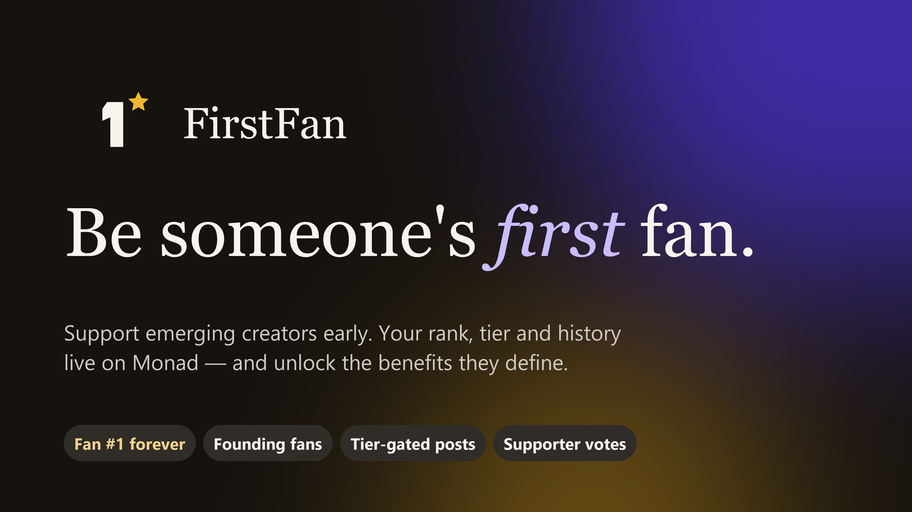

# FirstFan — be someone's first fan



**FirstFan is an on-chain creator community that turns early support into verifiable participation and meaningful creator-defined benefits.**
Fans discover and support emerging creators; a smart contract on Monad records every contribution, gives each fan a
permanent rank (fan #1, #2, #3…), and decides who can unlock exclusive work and vote on creator decisions.

Built for **Monad Metropolis 2026 — Social, Attention & Culture**.

| | |
|---|---|
| Live app | **https://firstfan-pink.vercel.app** |
| Network | Monad Testnet (chain ID `10143`) |
| Contract | [`0xbd94cA0133E3dE9f57eD5111A6f48b901B6a5Aa8`](https://testnet.monadscan.com/address/0xbd94cA0133E3dE9f57eD5111A6f48b901B6a5Aa8) |
| Explorer | https://testnet.monadscan.com |

> Testnet MON has no monetary value. FirstFan does not promise returns, profit sharing or financial rewards —
> benefits are access, recognition and a say in what creators make next.

---

## The problem
Emerging creators — campus photographers, illustrators, musicians — struggle to find their first audience.
Today's platforms reward likes and follower counts, and the people who believed in a creator first get nothing
that proves it: no recognition, no access, no voice.

## What FirstFan does
1. **Discover** emerging creators and their work in a visual feed (filter by public/exclusive and craft).
2. **Support early** with a real on-chain transaction. The contract assigns a **permanent rank** on your first
   support and tracks your cumulative total. The first _N_ supporters (creator-defined) become **Founding fans**.
3. **Unlock benefits the creator defines**: up to five tiers (cumulative MON thresholds + perk). Exclusive posts
   are encrypted and stored on-chain; they're only decrypted for wallets the contract confirms as eligible.
4. **Vote** in creator polls — one vote per eligible supporter, enforced inside the contract.
5. **Carry your record**: the **Supporter passport** (`getFanPassport(address)`) lists every creator a wallet
   backed with rank, tier and founding status. Any app can verify it.
6. **Pulse**: platform-wide analytics computed from every `Supported` event (earliest believers leaderboard,
   creators gaining fans this week, daily activity, tx-linked history) — indexed by **Envio HyperSync**.

Creators get a **Studio**: register a handle, set founding spots and tiers, publish public or gated posts, run
polls and withdraw support (pull-based, reentrancy-safe).

## Why on-chain (and not just a database)
- **Rank is the product.** "I was fan #3" only matters if nobody — including us — can rewrite it. Ranks,
  totals and timestamps are contract state, verifiable on Monadscan.
- **Benefits are enforced, not promised.** Unlocking and voting depend on `canAccess()` / `tierOf()` reads of
  that state. The frontend never decides eligibility.
- **Portable recognition.** Your early-support history isn't locked into FirstFan; it's a public record any
  community, venue or future platform can read.
- **Monad makes it usable.** Fast blocks and low fees make small, frequent support transactions and per-support
  records (with notes) practical.

## Architecture

```
 Browser (Next.js + wagmi/viem, injected wallet)
   │  writes: support / registerCreator / publishPost / createPoll / vote / withdraw  ──► Monad Testnet
   │  reads:  /api/rpc  (read-only JSON-RPC proxy, method allow-list) ──► Alchemy Monad RPC (or public RPC)
   │  unlock: /api/unlock  (wallet signature + contract canAccess check) ──► decrypt sealed post
   │  seal:   /api/seal    (registered creators only) ──► AES-256-GCM ciphertext stored on-chain
   └  pulse:  /api/pulse   ──► Envio HyperSync (all Supported events + tx hashes + block times)
                               fallback: contract's own support log
```

### Smart contract — `contracts/contracts/FirstFan.sol`
- `registerCreator(handle, name, bio, avatarURI, category, foundingSlots, tiers[])` — unique lowercase handle.
- `support(creator, note)` payable — min 0.001 MON, no self-support. Assigns rank on first support, updates
  totals, appends a `SupportEntry`, emits `Supported(supportId, creator, supporter, amount, supporterTotal, rank, note)`.
- `publishPost(access, title, body, imageURI, sealedContent)` — `access`: 0 public, 1..n tier, 255 founding fans.
- `createPoll(access, question, options[2..4], duration)` / `vote(pollId, option)` — eligibility checked on-chain.
- `withdraw(to)` — checks-effects-interactions + `nonReentrant`; balance zeroed before transfer.
- Views: `tierOf`, `isFoundingFan`, `canAccess`, `canAccessPost`, `getSupporter`, `getSupporters`,
  `getFanPassport`, `getCreatorSupports`, `getRecentSupports`, `getRecentPosts`, `getCreatorPosts`, `getCreatorPolls`.
- Founding slots can grow but never shrink, so founding status can't be taken away.

### Exclusive content (the enforceable benefit)
1. Creator writes exclusive text/image/link → `/api/seal` verifies the address is a registered creator and
   encrypts with AES-256-GCM (key from `SEAL_SECRET`, **AAD = creator address**, so ciphertext can't be
   re-published under another creator).
2. The ciphertext is stored on-chain with the post.
3. A fan signs a free session message (no transaction). `/api/unlock` verifies the signature (EOA or smart
   wallet via viem `verifyMessage`), reads `getPost` + `canAccess(creator, fan, access)` from the chain, and only
   then decrypts. Sessions expire after 24h.

### Sponsor integrations
- **Envio — HyperSync** (`web/src/lib/pulse.ts`): the Pulse page and its leaderboards are computed from a full
  HyperSync scan of `Supported` events on Monad Testnet (`https://10143.hypersync.xyz`), joining each log with its
  transaction hash and block timestamp — data the contract alone can't serve efficiently. Requires
  `ENVIO_API_TOKEN`; without it the page clearly shows "Source: contract storage".
- **Alchemy — Monad RPC** (`web/src/lib/server.ts`, `web/src/app/api/rpc/route.ts`): when `ALCHEMY_API_KEY` is
  set, every server read (unlock checks, sealing checks, health, pulse fallback) and every browser read (through the
  `/api/rpc` proxy, so the key never reaches the client) goes through `https://monad-testnet.g.alchemy.com/v2/…`.
  `/api/health` reports which provider is active.

## Repository layout
```
contracts/   Hardhat project: FirstFan.sol, tests, deploy/seed/export-abi scripts
web/         Next.js 15 app (App Router), API routes, components
assets/      Logo and cover graphics for the submission
docs/        Demo script, pitch script, submission checklist
```

## Run locally
Prereqs: Node 20+.

```bash
# 1. Contracts: test, start a local chain, deploy + seed demo data
cd contracts
npm install
cp .env.example .env            # fill DEMO_PRIVATE_KEYS (5 keys) and SEAL_SECRET
npx hardhat test
npx hardhat node                # in a separate terminal
npx hardhat run scripts/deploy.ts --network localhost
npx hardhat run scripts/seed.ts --network localhost

# 2. Web app
cd ../web
npm install
cp .env.example .env.local      # NEXT_PUBLIC_CHAIN=local, NEXT_PUBLIC_CONTRACT_ADDRESS=<from deployments/localhost.json>, same SEAL_SECRET
npm run dev
```

### Deploy to Monad Testnet
```bash
cd contracts
# .env: DEPLOYER_PRIVATE_KEY funded from https://faucet.monad.xyz
npx hardhat run scripts/deploy.ts --network monadTestnet   # writes deployments/monadTestnet.json
npx hardhat run scripts/seed.ts --network monadTestnet     # optional demo data (labelled as demo)
```
Then set the web env vars (`NEXT_PUBLIC_CONTRACT_ADDRESS`, `NEXT_PUBLIC_DEPLOY_BLOCK`,
`NEXT_PUBLIC_DEMO_ADDRESSES`, `SEAL_SECRET`, `ALCHEMY_API_KEY`, `ENVIO_API_TOKEN`) on your host and deploy `web/`.

## Testing
- `cd contracts && npx hardhat test` — 18 tests: registration & validation, rank/tier/founding logic, access
  rules, post validation, polls (eligibility, double vote, closing), withdraw, rejecting receiver, reentrancy attack.
- `node web/scripts/e2e-unlock.mjs <baseUrl> <eligibleFanKey> <chainId>` — server-side checks for unlock/seal/RPC
  proxy: eligible unlock, cross-creator denial, stranger denial, forged and expired signatures, seal auth, write
  methods blocked.
- `cd web && npx tsc --noEmit && npx next build`.

## For judges
1. Open the live app — no wallet needed to browse the feed, creators, supporter walls, Pulse and passports.
2. Connect MetaMask/Rabby; the app prompts to add/switch to **Monad Testnet (10143)**.
3. Get free testnet MON at https://faucet.monad.xyz.
4. Support a creator → watch pending → confirmed with an explorer link and your rank.
5. Unlock a gated post you now qualify for (sign once, free) and vote in the poll.
6. Open your passport. To test the creator side, use a second wallet in Studio.

Accounts badged **Demo account** were created and funded by the FirstFan team so the product is explorable.
Their transactions are real on-chain transactions, but they are not real community members or traction.

## Deployments
Verified on Monad Testnet (chain `10143`). The deployed runtime bytecode matches the compiled artifact.

| What | Value |
|---|---|
| FirstFan contract | [`0xbd94cA0133E3dE9f57eD5111A6f48b901B6a5Aa8`](https://testnet.monadscan.com/address/0xbd94cA0133E3dE9f57eD5111A6f48b901B6a5Aa8) |
| Deploy transaction | [`0x3ba3c69e…cd1a6`](https://testnet.monadscan.com/tx/0x3ba3c69e07c5d1d984a23a033b500bcd9142689295f76fcde2019651cb0cd1a6) (block 70479257) |
| Deployer | `0x0260FB0941B15d53fE955B548f47EE481c3ef458` |
| Web app | https://firstfan-pink.vercel.app (status: [/api/health](https://firstfan-pink.vercel.app/api/health)) |

Demo accounts (seeded and funded by the FirstFan team, badged "Demo account" in the app — `contracts/deployments/monadTestnet.demo.json`):

| Role | Address |
|---|---|
| Creator `maya_frames` | `0x75c7aF48872c4E374a13358f7DBF5c70Be0c5D0f` |
| Creator `noor_loops` | `0xfeD08516e3a30b3BA5B614FFBA876A278eb9935A` |
| Creator `arjun_draws` | `0xAd50d4da3038F535098ae8580b2b74055d7749C5` |
| Fan | `0x0295844F50202a9A805208b331855e5d97f6C2f9` |
| Fan | `0x48bb472D9Af8FF5c53F023048ACAA7C76B4827FF` |
| Team UI test wallet | `0x6301bb6B5c8FD25FBa9AD69D47743103b72E96DF` |

Example real UI transaction (support → fan #3 of `maya_frames`):
[`0xbbf06dac…20e8aa`](https://testnet.monadscan.com/tx/0xbbf06dac51e4d1481ef0701a4062994e657c5e460215b93a0bcc5c35d220e8aa).

## Roadmap
- Campus pilot: onboard 10 photographers/illustrators from the founder's campus photography community.
- Creator-issued real-world perks (prints, gig guest lists) redeemed against founding status.
- Open "proof of early support" API so venues and other platforms can recognise early fans.
- Mainnet launch with stablecoin support amounts and optional soulbound passport stamps.

## License
MIT
